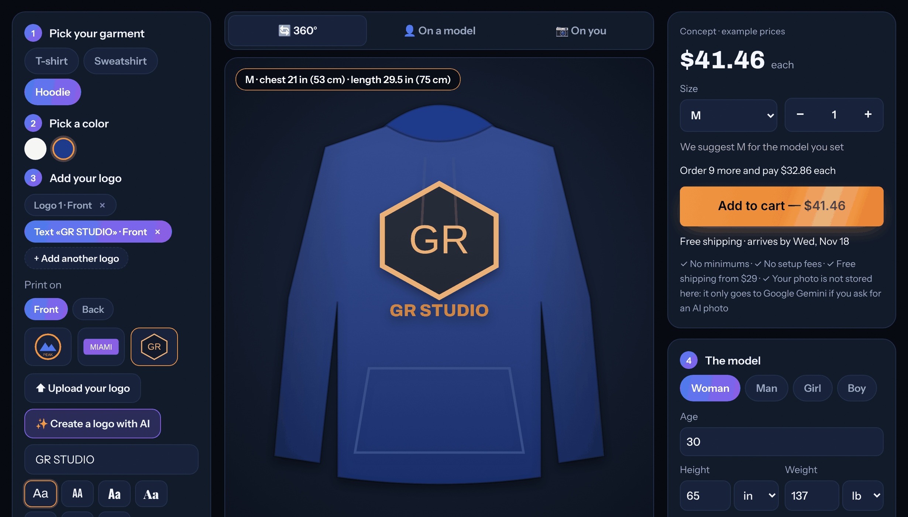

# AI Apparel Design Studio

A browser-based studio for custom apparel. Design a T-shirt, sweatshirt or hoodie, turn it in 360°, see it on a model or on yourself through the camera, have AI draw a logo, and get a size suggestion with an example price.

**Live demo:** https://www.gilberthroca.com/work/#design



*This screenshot shows the repository running on its own, with the drawn garment. The live demo uses photos instead (see [Photo assets](#photo-assets-optional)).*

## Features

- **Garment editor.** T-shirt, sweatshirt or hoodie, in white or navy blue. Add up to six pieces, each on the front or the back:
  - one of three sample logos, your own image or an AI logo;
  - text in 7 typefaces (Archivo, Bebas Neue, Oswald, Playfair Display, Pacifico, Permanent Marker, Courier Prime) and 7 colours, or a colour picked from the page;
  - a freehand drawing.

  Change size and position with a slider, chest presets, arrow nudges or by dragging.
- **360° view.** The live site uses photos of each garment on an invisible mannequin, taken from four angles. The page recolours them and prints the logos into the fabric's folds, at the real size of the chosen size. When those photos are absent, the view shows the drawn garment, front or back.
- **On a model.** Pick a woman, man, girl or boy and set age, height and weight (in/cm, lb/kg). The page works out the build from the BMI and suggests a size. The live site shows real model photos with the design printed on them; without the photos you get a drawn figure in any of seven skin tones. **Realistic AI photo of this model** asks the image model for a catalogue photo of that person wearing the design.
- **On you.** Use the live camera or an uploaded photo. Body tracking (MediaPipe Pose Landmarker) and clothes segmentation run on the device. The clothes are recoloured live and the logo follows the chest. There is an optional 3 s or 10 s timer. **Create a realistic photo with AI** sends the photo and the design to the image model.
- **AI logo.** A short description goes to the image model, which draws a flat logo on white. The page removes the white that touches the edges, crops the result and puts it on the garment. The last six AI logos are kept in the visitor's own browser (IndexedDB).
- **Concept ordering.** Example prices with quantity tiers (1 / 10 / 25 / 50 / 100 / 500), youth and adult tables, a size suggestion, a delivery-date estimate and free shipping from $29. **Add to cart** only confirms the choice: there is no cart page and no checkout.
- **English / Spanish** switch, remembered in the browser.

## Tech stack

- Plain HTML, CSS and JavaScript, with no framework and no build step. All drawing and image processing use Canvas 2D.
- [MediaPipe Tasks Vision](https://ai.google.dev/edge/mediapipe/solutions/vision/pose_landmarker) 0.10.14 for on-device body tracking and segmentation. It loads on demand from jsDelivr, and the models load from Google's storage.
- Google Gemini image model (`gemini-nano-banana-2.1`, falling back to `gemini-3.1-flash-image`), called over REST from the server.
- One Cloudflare Pages worker (`_worker.js`). It holds the API key, checks requests and serves the static files.
- IndexedDB and localStorage for the visitor's AI logos and language; Google Fonts.

## Structure

```
index.html          Page markup
css/styles.css      Styles
js/app.js           Editor, 360° view, model view, try-on, AI client, pricing and language switch
js/i18n-es.js       Spanish translations
_worker.js          Cloudflare Pages worker: POST /api/tryon (AI photo, AI model photo, AI logo)
docs/screenshot.png The screenshot above
LICENSE             MIT
```

## Run locally

The site is static files with no build step. Serve the folder with any static server, for example:

```
npx serve .
```

or `python3 -m http.server 8000`. Open the page on `localhost`: browsers allow the camera only on `localhost` or HTTPS.

**Without the worker**, everything works except the three AI buttons:
- the editor;
- the 360° and model views (with drawn fallbacks);
- camera and photo try-on (this needs an internet connection for the MediaPipe files);
- pricing and the language switch.

The three AI buttons are **Create a logo with AI**, **Create a realistic photo with AI** and **Realistic AI photo of this model**. Without the worker they show an error message.

**With the worker**, run it locally with Wrangler. Put a `.dev.vars` file next to `_worker.js`; it is git-ignored:

```
GEMINI_API_KEY=your-key
ALLOWED_ORIGINS=http://localhost:8788
```

Then:

```
npx wrangler pages dev .
```

Open http://localhost:8788. `ALLOWED_ORIGINS` must match the address in the browser bar exactly, scheme and port included.

### Photo assets (optional)

The live site shows photos in the 360° and model views. The photos are not in this repository. They were generated once with the image model: the 360° base photos through the worker's `product` mode. To use your own, define three globals in a script that runs before `js/app.js`:

```html
<script>
  window.PRODUCT_PHOTOS = ['product-tee-front', 'product-tee-threequarter', /* … */];
  window.MODEL_PHOTOS = ['woman-adult-average-tee', 'woman-adult-average-tee-blue', /* … */];
  window.ASSET_V = '1'; // cache-busting version for the 360° files
</script>
```

The page then loads these files:

- **360°:** `work-assets/products/product-<tee|sweat|hoodie>-<front|threequarter|side|back>.map.webp`, relative to the page.
  - The red channel holds the fabric's light; the green channel is the garment mask.
  - Each image has a `.json` file next to it, with `box: [x, y, width, height]`.
  - A garment needs all four angles.
- **Models:** `https://gilberthroca-media.pages.dev/models/<name>.webp`, plus `<name>.skin.png` (a skin mask) and `<name>.json` (`mx`, `my`, `sw`, `ang`, `hipY`: shoulder centre, shoulder width, angle and hip line).
  - `<name>` is `<woman|man|girl|boy>-<young|teen|adult>-<build>-<tee|sweat|hoodie>`, with optional `-<tone>` and `-blue` (the navy shirt) suffixes.
  - The media host must send CORS headers.

Any garment or model missing from the lists falls back to the drawn version.

## Deploy (Cloudflare Pages, advanced mode)

The folder is deployed as it is. Because `_worker.js` sits at the root, Pages runs in "advanced mode": the worker answers `POST /api/tryon` and hands every other request to the static files (`env.ASSETS`).

1. Deploy. Either run:

   ```
   npx wrangler pages deploy . --project-name <your-project>
   ```

   or connect the repository in the Cloudflare dashboard with no build command and `/` as the output directory.
2. Add the API key as a secret:

   ```
   npx wrangler pages secret put GEMINI_API_KEY --project-name <your-project>
   ```

3. Optionally, set these in **Settings → Variables and Secrets**:

| Name | Default | What it does |
|---|---|---|
| `ALLOWED_ORIGINS` | `https://gilberthroca.com,https://www.gilberthroca.com` | Comma-separated origins whose pages may call `/api/tryon`. **Set it to your own domain(s)**, e.g. `https://<your-project>.pages.dev`, or every AI request is refused with 403. |
| `TRYON_MODEL` | `gemini-nano-banana-2.1` | Another Gemini image model id. |
| `ADMIN_TOKEN` | not set | A secret. It enables `product` mode (the 360° base photos) for requests that send the same value in an `X-Admin-Token` header. Without it, that mode is refused. |

### The endpoint

`POST /api/tryon` takes JSON. `mode` chooses the job:

| Mode | What it makes |
|---|---|
| (none) | The visitor's photo (`person`) wearing the designed garment (`garment`, a PNG) |
| `model` | A catalogue model with the given `who`, `age`, `heightCm`, `weightKg`, `skin`, `build` and `size`, wearing the garment |
| `logo` | A flat logo from `prompt` (at least 3 characters, cut to 300) |
| `product` | Owner only: a plain garment on an invisible mannequin, from one `angle` |

All modes return Gemini's JSON answer unchanged. On errors the worker returns:
- `405` for anything but POST;
- `403` for an origin not on the list, or `product` mode without the token;
- `503` when the key is not set;
- `413` for a body over 8 MB;
- `429` when a rate limit is hit;
- `400` for bad input;
- `424` when Gemini fails. The 424 carries only Google's error status (e.g. `RESOURCE_EXHAUSTED`), never its full message.

## Cost protection

Every AI button press costs money on the Gemini key, roughly $0.03–0.04 per image at the time of writing. The worker's own limits are **not** a budget guard:

- **The origin check** stops other websites' pages from using the endpoint. A script can send any `Origin` header it likes.
- **Per-IP limits** cap each IP at 15 requests an hour in total, of which at most 5 can be logos. They live in the memory of one worker instance only. Cloudflare runs many instances and recycles them, and a client can change its IP. So these limits stop a browser that loops by mistake, not a determined abuser.

Protect the key in Google Cloud, in the project that owns it:

1. **Quota:** in *APIs & Services → Generative Language API → Quotas*, lower the requests-per-day limit to what the demo needs. The quota is a hard stop.
2. **Budget alert:** in *Billing → Budgets & alerts*, create a budget with email alerts. An alert notifies you; it does not stop spending.
3. **Key restriction:** in *APIs & Services → Credentials*, restrict the key to the Generative Language API.

## Privacy

- **Camera and photos stay on the device.** Body tracking, segmentation and recolouring run in the browser. A photo leaves the device only when the visitor asks for an AI photo. The page then sends the photo (scaled to at most 1024 px) and a flat picture of the design to `/api/tryon`, which forwards them to Google's Gemini API to make the image.
- **Nothing is stored server-side.** The worker stores nothing. Google's [Gemini API terms](https://ai.google.dev/gemini-api/terms) apply to what is sent, including how Google may log or use data on unpaid plans.
- **AI logos and the language choice** are kept only in the visitor's browser (IndexedDB and localStorage).
- **Third-party hosts.** The page loads fonts from Google Fonts and, for the camera try-on, MediaPipe from jsDelivr and Google's storage. With the photo assets configured, it also loads the model photos from the media host.

## How it was built

Built by directing AI coding agents (Claude Code) end to end: specification, implementation, browser testing on phone and desktop, and code review.

## License

[MIT](LICENSE) © 2026 [Gilberth Roca](https://www.gilberthroca.com)
